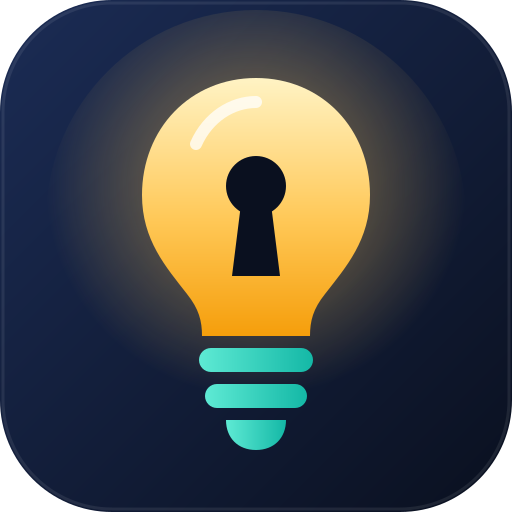

# Lumen

**Your secrets, kept in the light.**

Password, card and secure-note manager. Local-only, end-to-end encrypted, PIN + biometric unlock, Arabic / English / 简体中文.

### [▶ Try it in your browser](https://l7v0l.github.io/lumen-vault/)

[Browser / Mobile](https://l7v0l.github.io/lumen-vault/) · [Windows desktop](https://github.com/l7v0l/lumen-vault/releases/latest)

## Features

- **Logins, bank cards and secure notes** in one encrypted vault
- **Strong encryption** — Argon2id key derivation + XChaCha20-Poly1305, tamper detection
- **Unlock your way** — master password, PIN (auto-wipes after 5 wrong tries) or biometrics (Windows Hello, Face ID, Android fingerprint/face via the OS)
- **Local-only** — nothing leaves your device, no account, no tracking
- **Password generator** with strength meter
- **Auto-lock** on idle and **clipboard auto-clear** after 20 seconds
- **Encrypted backup** export and import
- **Cinematic intro** — tap the lightbulb and the vault lights up
- **Arabic (RTL), English and Chinese** interface
- **Works everywhere** — any modern browser, installable on your phone ("Add to Home Screen"), and a Windows desktop app

## Try it

- **Browser:** https://l7v0l.github.io/lumen-vault/
- **Mobile:** open the link above in Chrome/Safari → menu → *Add to Home Screen*
- **Desktop:** download the latest Windows build from [Releases](https://github.com/l7v0l/lumen-vault/releases/latest)

> Security notes and honest limits: [docs/SECURITY.md](docs/SECURITY.md). Not independently audited.

## License

MIT
